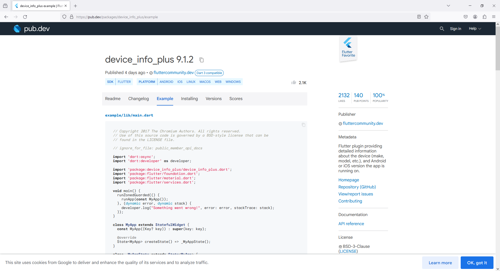

```
https://pub.dev/packages/device_info_plus
```

`device_info_plus` is a Flutter plugin used to retrieve device and operating system information. It supports Android, iOS, macOS, Web, Linux, and Windows.

### Core Usage

Instantiate `DeviceInfoPlugin`, then use the getters corresponding to the platform to retrieve information:

```dart
import 'package:device_info_plus/device_info_plus.dart';

DeviceInfoPlugin deviceInfo = DeviceInfoPlugin();

// Android
AndroidDeviceInfo androidInfo = await deviceInfo.androidInfo;
print('Running on ${androidInfo.model}'); // e.g. "Moto G (4)"

// iOS
IosDeviceInfo iosInfo = await deviceInfo.iosInfo;
print('Running on ${iosInfo.utsname.machine}'); // e.g. "iPod7,1"

// Web
WebBrowserInfo webBrowserInfo = await deviceInfo.webBrowserInfo;
print('Running on ${webBrowserInfo.userAgent}');
```

### For Crash Reporting / Telemetry Scenarios

If you don't care about specific fields and just want to send all device information to the backend, you can use the `deviceInfo` property to get generic data:

```dart
final deviceInfoPlugin = DeviceInfoPlugin();
final deviceInfo = await deviceInfoPlugin.deviceInfo;
final allInfo = deviceInfo.data;
```

**Note**: The data returned by `data` is not fully JSON serializable, so don't treat it as strict JSON.

### Platform-Specific Notes

- **Android serial number**: Only retrievable when the app meets official conditions; otherwise returns `unknown`.
- **iOS device name**: The `name` property (user-assigned device name) requires special entitlement in iOS 16 and later; without it, it will always return `iPad` or `iPhone`.

### Version and Requirements (Recent Versions)

Recent versions (such as 12.x/13.x) have relatively new requirements. For example, version 12.4.0 requires Flutter >= 3.29.0, Dart >= 3.7.0, iOS >= 12.0, macOS >= 10.14, and Android side requires Java 17, Kotlin 2.2.0, AGP >= 8.12.1, Gradle >= 8.13. Version 13.2.0 was released in June 2026 with changes including Kotlin migration, etc.. It is recommended to refer to the requirements on pub.dev before actual integration.

```dart
import 'package:device_info_plus/device_info_plus.dart';

// Get Device Info
DeviceInfoPlugin deviceInfo = DeviceInfoPlugin();
String _deviceName = '';

void getDeviceName() async {

  try {

    if(Platform.isAndroid)
    {

      AndroidDeviceInfo androidInfo = await deviceInfo.androidInfo;

      // e.g. "Moto G (4)"
      _deviceName = androidInfo.model;

    }
    else if(Platform.isIOS)
    {

      IosDeviceInfo iosInfo = await deviceInfo.iosInfo;

      // e.g. "iPod7,1"
      _deviceName = iosInfo.utsname.machine;

    }

  }
  catch (e) {

  }

}
```
`HomeScreen.dart`
```
import 'dart:io';

import 'package:flutter/foundation.dart' show kIsWeb;
import 'package:flutter/material.dart';
import 'package:device_info_plus/device_info_plus.dart';

class HomeScreen extends StatefulWidget {
  const HomeScreen({super.key});

  @override
  State<HomeScreen> createState() => _HomeScreenState();
}

class _HomeScreenState extends State<HomeScreen> {
  final DeviceInfoPlugin _deviceInfo = DeviceInfoPlugin();
  String _deviceName = '';

  @override
  void initState() {
    super.initState();
    _getDeviceName();
  }

  Future<void> _getDeviceName() async {
    String name = '';

    try {
      if (kIsWeb) {
        final webInfo = await _deviceInfo.webBrowserInfo;
        name = webInfo.browserName.name;
      } else if (Platform.isAndroid) {
        final androidInfo = await _deviceInfo.androidInfo;
        name = androidInfo.model; // e.g. "Moto G (4)"
        name += "\n" + Platform.operatingSystem;
      } else if (Platform.isIOS) {
        final iosInfo = await _deviceInfo.iosInfo;
        name = iosInfo.utsname.machine; // e.g. "iPhone15,2"
      } else if (Platform.isMacOS) {
        final macInfo = await _deviceInfo.macOsInfo;
        name = macInfo.model;
      } else if (Platform.isWindows) {
        final winInfo = await _deviceInfo.windowsInfo;
        name = winInfo.computerName;
      } else if (Platform.isLinux) {
        final linuxInfo = await _deviceInfo.linuxInfo;
        name = linuxInfo.prettyName;
      }
    } catch (e, st) {
      debugPrint('Failed to get device name: $e\n$st');
      name = 'Unknown device';
    }

    if (!mounted) return; // widget may have been disposed
    setState(() => _deviceName = name);
  }

  @override
  Widget build(BuildContext context) {
    return Scaffold(
      appBar: AppBar(
          title: const Text('Home'),
          actions: [
            IconButton(
                onPressed: () {
                  _getDeviceName();
                },
                icon: Icon(Icons.refresh)
            )
          ],
      ),
      body: Center(
        child: Text(_deviceName.isEmpty ? 'Loading…' : _deviceName),
      ),
    );
  }
}
```

